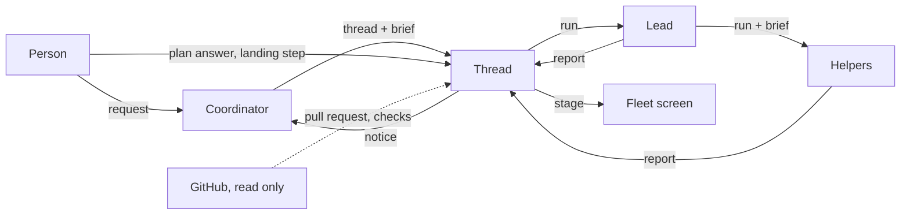

# 001 Domain model

This document names the concepts of herdr-fleet and the rules each one keeps. The code, the role files, the Fleet screen and the later documents use these terms; [GLOSSARY.md](../GLOSSARY.md) lists them in short. Following [000 Philosophy](000-philosophy.md), the model holds only the concepts the work needs, and marks each rule Built or Planned.

The model follows [dsh-superagent's](https://github.com/deepseek-ai/dsh-superagent-prototype/blob/main/docs/001-domain.md), adapted to a fleet that serves one person on one machine. One word needs care: a fleet **thread** is what dsh calls a Ticket, not what dsh calls a Thread.

## Flow

The person sends a request to a project's coordinator. The coordinator starts a thread for each independent piece of work, with a brief. A thread works through runs: its lead, and the helpers the lead starts. Each of their turns ends with a report. From the reports and the other structured facts of a thread, the fleet works out the thread's stage, and sends notices to the coordinator about what the person or the coordinator has to know. The person answers plans and presses landing steps on the Fleet screen; the lead pushes and opens the pull request, and the coordinator merges, on the person's step or, where the person made the project's merge authority gated, when every condition of the gate holds.

## Concepts

| Concept | Definition | Rules it keeps | dsh | Status |
| --- | --- | --- | --- | --- |
| Project | A repository, known by its main checkout's path, or a folder outside one | Has at most one live coordinator. A second request for the same project goes to the live one | — | Built |
| Coordinator | The run that talks with the person about one project, on its main checkout | Edits no file. Starts threads, passes the person's decisions on, and merges a thread only on a merge step the person pressed, or on its own under gated merge authority, and reverts one only on the person's Revert step. Never answers a plan or an approval on a thread's screen | Main Session | Built |
| Thread | One piece of a project's work, with its own herdr workspace and, in a repository, its own worktree on the branch `fleet/<id>` from the branch the main checkout was on | Has one lead at a time and keeps its worktree, branch and pull request across its runs. Ends merged or discarded, and only then do its worktree and branch go | Ticket | Built, as the lead's run (below) |
| Run | One agent the fleet started in a herdr pane with a role, followed turn by turn until it settles | Belongs to one group. Has its own result folder. A run that fails its first turn hands its task to the next configured candidate | Assignment | Built |
| Role | What an agent is told to be and how it runs: a file in `agents/`, overridden by the person's and the project's | Says whether the role edits files, may start other agents and talks in its pane. A role that edits no file runs only on a CLI the fleet can hold to that | Preset and prompt parts | Built |
| Brief | What a caller hands to a thread or a helper: goal, the paths it may write, context, done, verify | Required when an agent hands work on; the person may give a task in a line. The fleet refuses a helper whose paths another working run holds | Mandate's scope | Built |
| Turn | One prompt to a run, until the run settles, blocks or fails | A lead's or a helper's ends with a report; the coordinator writes none | Executor turn | Built |
| Report | What a run leaves at the end of a turn for its thread | Is the only source of the run's outcome and of a question for the person | Report | Built as free text; structured Planned (slice A) |
| Contract | A lead's three to seven checkable assertions, each met, open or unmet | Its state goes into the lead's report | — | Built |
| Plan | A lead's tree of claims before a large change, with the decisions it asks | Waits for the person's answers on the Fleet screen; the answers go to the lead as one message | Attention | Built |
| Stage | Where a thread stands, by what it waits for | One stage at a time; the first matching row of a table wins; worked out from stored facts, never from an agent's prose | Ticket stage | Built from the lead's run; table Planned |
| Notice | A message from the fleet to a coordinator or a lead, opening with `[fleet]` | Says it comes from the fleet, not the person. Goes out only when its receiver is free | Notice | Built, one slot per thread; stored Planned (slice C) |
| Landing step | A step the person pressed to land a thread: update the branch, create a pull request, fix CI, send review comments, merge, merge the pull request, revert a merge, or discard | Each approves that step only. The lead takes the branch steps, the coordinator the merges and the revert, and the fleet itself only discard | Mandate, as the person's approval | Built |
| Merge authority | Who may merge a project's threads: the person (`person`, the default), or the coordinator alone when every condition of a gate holds (`gated`) | Set per project in the person's own `fleet.json`, explicitly; never read from the repository's own files. A change to the gate itself always waits for the person | Mandate's strength (explicit, not inferred) | Built |
| Subscription | A thread following its pull request on GitHub, read only | Review comments and check changes reach the thread's lead as notices; nothing is written to GitHub | Subscription | Planned |

The person is not a domain concept. There is one, and what they do reaches the fleet as a request, a plan answer or a landing step.

A **group** (`group` in code, the "fleet" an agent's instructions name) is the set of runs that see and message each other: a coordinator's, or a thread's lead and its helpers. It scopes the `fleet` command, not the domain.

### A thread and its runs

The thread is the unit of work; a run is the binding of that work to one agent in one pane. dsh keeps the two apart, so a Ticket's state does not follow the Executor's, and so should the fleet.

- **Built:** a thread is its lead's run. Its id is the run's id, its state is worked out from the run's herdr state and last report (`threadState` in `shared/fleet.ts`), and the Fleet screen and `fleet threads` list lead runs. A lead whose first turn fails is replaced by the next fallback candidate, as a new run that is then the thread.
- **Planned (slice A, in progress):** a thread whose lead fails or ends a turn without a report gets a new lead run on another CLI, in the same worktree, branch and group, told to check the worktree, git history and GitHub before repeating any outside action. The old run names its replacement, and the thread goes on.

### Reports

- **Built:** the report is the HANDOFF section an agent writes to `handoff.md` in its result folder, and `contract.md` beside it for a lead. The fleet reads the status line, the first line that opens with PASS, ISSUES or BLOCKED, by pattern, and the contract's marks.
- **Planned (slice A, in progress):** each turn writes `report.json` with structured fields: a state, a summary, the evidence, and an optional question for the person (`human_action`). A missing or malformed file is the explicit outcome "no report", whatever `handoff.md` or the screen says. No status line is read from prose.

### Notices

- **Built:** a thread holds at most one notice for its coordinator (`notice` on the run). A newer notice replaces an older one that was not delivered. It goes out when the coordinator is free: no turn of the fleet's in flight, herdr calls it settled, and no draft of the person's in its input.
- **Planned (slice C, in progress):** every notice to a coordinator or a lead is stored first and typed afterwards, in the order written, once, across a restart.

## Rejected concepts

| Rejected | Reason |
| --- | --- |
| A thread's state that follows its lead's pane | An agent fails, is replaced or restarts; the thread goes on. The code still does this until slice A |
| Reading "waiting on the person" from a report's prose | It needs structured facts. The code still reads the BLOCKED status line until slice A |
| dsh's Source, Trigger, Eval and Policy | There is one person, who asks the coordinator directly; nothing has to judge whether a stranger's message is a request. Access to the server is access control, not Policy |
| An allowed list or identities | One person, signed in through their own CLIs and `gh` |
| Merge authority read from a repository's own role files (`.herdr-fleet/agents/`) | They come with the repository, which would grant itself merges; dsh's Mandate strength is explicit, not inferred. The fleet's instructions tell every lead never to merge, whatever a role file says (002) |
| The fleet server writing to GitHub | Writes are the person's approval, carried out by an agent the person can watch (002) |
| A ticket store of its own | A project's issues stay where the project tracks them; a thread names the issue in its brief |
| An agent declaring that the person must decide | Only a structured field of a report, a plan or a landing step that went wrong makes a thread wait for the person |

## What is reusable

The concepts above and their rules are what the fleet keeps as it changes. The agent CLIs (`server/fleet/adapters.ts`), the roles in `agents/`, and the screens are its present implementations.

| Part | In this repository |
| --- | --- |
| Agent CLIs | pi, Claude Code, Codex, Cursor, Antigravity (agy), OpenCode 2, each behind one adapter |
| Panes | herdr workspaces and tabs, one workspace per thread |
| Workspace | a git worktree under `.herdr-fleet/worktrees/<id>` in the project |
| Reads of GitHub | `gh`, signed in as the person (`server/fleet/github.ts`) |
