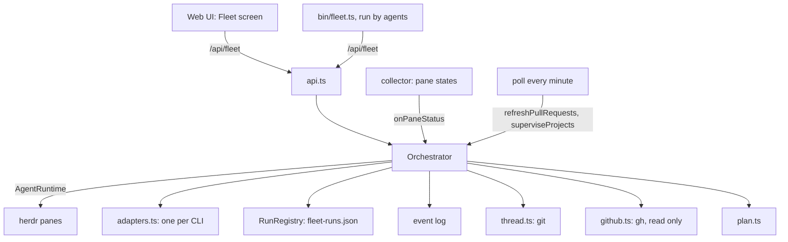

# 006 Architecture

This is the developer's map from the concepts of [001 Domain model](001-domain.md) through [005 Fleet screen](005-screen.md) to the code. `CLAUDE.md` holds the rules for working in the repository, and the quirks of herdr and of each agent CLI.

## What runs

One Bun process (`server/index.ts`) serves the Web UI, its HTTP and WebSocket API, and the fleet. It talks to herdr over herdr's socket, follows every pane's state through the collector, and starts agents in herdr panes. Agents call back through `bin/fleet.ts`, a thin CLI over `/api/fleet/*`, found through the environment their pane gets (`HERDR_FLEET_URL`, `HERDR_FLEET_GROUP`, `HERDR_FLEET_DEPTH`, `HERDR_FLEET_RUN`).

## Modules

| Module | Holds | Concepts |
| --- | --- | --- |
| `server/fleet/orchestrator.ts` | Starting runs and threads, turns and their settling, notices, landing steps, plans, the supervision of autonomous projects | Thread, run, turn, notice, landing step, standstill, anomaly |
| `shared/fleet.ts` | The records the server keeps and the API sends: `AgentRun`, `ThreadState` and `threadState`, the status line and contract readers | Run, stage (Built) |
| `server/fleet/thread.ts` | A thread's git: worktree, branch, diff, landing checks, removal, setup | Thread workspace |
| `server/fleet/brief.ts` | The brief: required fields, rendering, write scopes and their overlap | Brief |
| `server/fleet/plan.ts`, `shared/plan.ts` | A lead's plan: parsing, code exhibits read safely from the worktree, answers | Plan |
| `server/fleet/github.ts` | Reading a thread's pull request and the project's merges and issues with `gh` | Pull request reads |
| `server/fleet/adapters.ts` | Everything one agent CLI does differently: launch arguments, ready and question screens, read-only guards, notes | Agent CLIs |
| `server/fleet/agents.ts`, `config.ts`, `settings.ts` | Roles, the person's and the project's `fleet.json`, standing orders, the Settings page | Role, standing orders |
| `server/fleet/registry.ts` | Every run's record, kept across restarts in one file (0600) | Run |
| `server/fleet/events.ts`, `metrics.ts` | The append-only event log and the factory metrics computed from it | Measuring |
| `server/fleet/usage.ts`, `model-lists.ts`, `models.ts` | Usage and cooldowns per account, each CLI's model list, and the choice of a candidate | Candidates |
| `server/fleet/api.ts`, `bin/fleet.ts` | `/api/fleet/*` and the CLI over it | — |
| `agents/*.md`, `standing.md` | The bundled roles and the standing orders | Role, prompts |
| `src/ui/fleetView.ts`, `src/components/fleet/` | The Fleet screen's view models and views | Screen |

## Where the planned work lands

These are the slices in progress and the later work, by where they change the code. Each slice is its own thread on its own branch; this map says where, not how.

| Work | Status | Where |
| --- | --- | --- |
| A: structured report, thread kept apart from its runs | Planned (in progress) | The report's file and reader, `orchestrator.ts` (settling a turn, replacing a lead), `shared/fleet.ts` (`threadState`), `events.ts` and `metrics.ts`, `agents/*.md` |
| B: role versions and tests of what models read | Planned (in progress) | `agents.ts` (the hash), `events.ts` (a role event), `metrics.ts`, a test of the bundled roles |
| C: stored notices | Planned (in progress) | A new outbox module under `server/fleet/`, through which `orchestrator.ts` types every notice |
| D: these documents | Planned (in progress) | `docs/000-…` onward, `GLOSSARY.md`, `server/docs-links.test.ts` |
| Stage table | Planned | One pure function from a thread's stored facts to its stage, in place of `threadState`, read by the Fleet screen, the coordinator's notices and `superviseProjects` |
| GitHub subscription | Planned | `github.ts` reads a thread's reviews and check changes; the poll turns a change into a notice for the thread's lead. Nothing writes to GitHub |
| Merge authority | Planned | A per-project mode in the person's own `fleet.json` (`config.ts`, `ProjectConfig`), never read from the repository; the coordinator merges alone only when the gate's conditions hold (002). It replaces today's path, where a project's role files let its lead merge |
| Undo and its measure | Planned | Merge events in `events.ts`, the change failure rate and the time to restore in `metrics.ts`, a Revert step on the Fleet screen |

## Persistence

| What | Where | Kept |
| --- | --- | --- |
| Runs | `<stateDir>/fleet-runs.json`, rewritten on each change | Across restarts; a run untouched for a week is dropped |
| Reports, contracts | `<stateDir>/fleet-results/<run id>/`, which the run's agent writes | As long as the run is in the registry |
| Plans | `<stateDir>/fleet-plans/<run id>.json`, written by the server only, apart from the folders agents write | As long as the run is in the registry |
| Instructions not yet sent | `<stateDir>/fleet-instructions/<run id>.md`, for a CLI that takes them in its first prompt | Until that prompt is sent |
| Usage | `<stateDir>/fleet-usage.json` | Across restarts |
| Events | `<stateDir>/fleet-events.jsonl`, one JSON line per event, appended | Without message text, reports or screens |
| Settings | The person's `~/.config/herdr-fleet/fleet.json`, the project's `.herdr-fleet/fleet.json` | — |

## Tests

| Test | Covers |
| --- | --- |
| `server/fleet/orchestrator.test.ts` | Runs, threads, turns, notices, landing, supervision, against a fake herdr runtime |
| `server/fleet/thread.test.ts`, `plan.test.ts`, `brief.test.ts`, `metrics.test.ts` | Each module through its exported functions |
| `server/fleet/adapters.test.ts`, `fixtures/screens/` | Each CLI's screens, through the screen corpus |
| `server/fleet/runtime.contract.test.ts` | The herdr runtime against a real herdr test session (integration suite) |
| `server/docs-links.test.ts` | Each numbered document links only to lower-numbered ones and the glossary |

`bun scripts/ci-tests.ts unit` runs every `*.test.ts` under `src`, `shared`, `server`, `scripts` and `bin` that needs no herdr; the integration suite runs the contract tests and those under `server/herdr/` and `server/pty/`.
